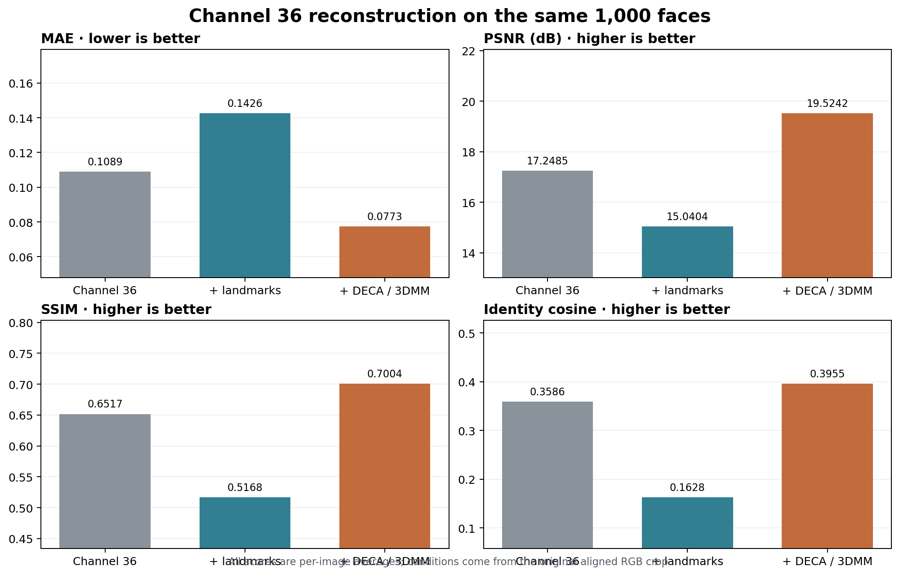

# 36 号 DCT 通道加入关键点与 3DMM 后的重建实验

> 实验结果：CASIA 训练 20 轮；固定 1,000 张 MS1Mv2 图像测试。详细逐图数据与训练配置保存在 `recognition/logs/conditioned_reconstruction_20261012/`。本报告补充[上一阶段报告](experiment_report_privacy_channel36_landmark_3dmm.md)的重建攻击评估。

## 目的和方法

先前穷举 64 个单频率位置后，36 号通道在 MAE、PSNR 与身份余弦相似度上表现为最难重建的候选。后续识别实验发现，加入关键点或 DECA/3DMM 条件可以提高验证准确率。本次直接回答隐私问题：**若重建器也获得这些额外条件，36 号通道的原图是否更容易被恢复？**

三组重建器都只接收 Y36、Cb36、Cr36 三张 DCT 特征图作为频率输入。原始基线采用原实验 20 轮 U-Net 检查点；新训练的两组分别加入 106 点热图（拼接到 U-Net 输入）与冻结 DECA 编码器的 236 维参数（用训练集统计标准化后调制 U-Net 瓶颈特征）。三组均用 CASIA，U-Net 宽度 76，每卡 batch 512，四卡训练 20 轮，SGD 与 L1 + 0.1 MSE 损失设置一致。水平翻转时关键点坐标同步翻转，DECA 则从翻转后的图像重新提取参数。

关键点和 DECA 参数均**从同一张原始对齐 RGB 图像得到**。因此下列结果评估的是“36 号频率 + 可获得的条件”的联合攻击面；如果实际系统只披露频率而不披露条件，攻击者是否能取得这些条件仍需单独界定。

## 固定测试集结果

表 1｜逐图计算后平均。MAE 越低、PSNR/SSIM/ID cosine 越高，表示重建器保留更多原图信息。ID cosine 是固定 IR-SE50 嵌入的余弦相似度，并非身份验证成功率。

| 模型 | MAE ↓ | PSNR ↑ / dB | SSIM ↑ | ID cosine ↑ |
| --- | ---: | ---: | ---: | ---: |
| 仅 36 号通道（原实验） | 0.1089 | 17.2485 | 0.6517 | 0.3586 |
| 36 号 + 106 点关键点 | 0.1426 | 15.0404 | 0.5168 | 0.1628 |
| 36 号 + DECA/3DMM | 0.0773 | 19.5242 | 0.7004 | 0.3955 |
| 关键点模型，推理时关闭条件 | 0.2448 | 10.3555 | 0.2969 | 0.0513 |
| DECA 模型，推理时关闭条件 | 0.1539 | 14.7385 | 0.6042 | 0.3258 |

表 2｜相对原始 36 号无条件模型的逐图平均差值及配对 bootstrap 95% 区间；随机种子 1337，重采样 3,000 次。

| 新模型 | ΔMAE | ΔPSNR / dB | ΔSSIM | ΔID cosine |
| --- | ---: | ---: | ---: | ---: |
| 36 号 + 106 点关键点 | +0.0337 [+0.0312, +0.0364] | -2.2081 [-2.3459, -2.0711] | -0.1348 [-0.1387, -0.1309] | -0.1959 [-0.2029, -0.1885] |
| 36 号 + DECA/3DMM | -0.0316 [-0.0331, -0.0301] | +2.2757 [+2.1610, +2.3888] | +0.0488 [+0.0463, +0.0513] | +0.0368 [+0.0327, +0.0409] |

**36 号 + 106 点关键点**相对独立训练的原始重建基线，MAE 更高，PSNR、SSIM 和 ID cosine 均更低，四项平均指标均显示重建效果更差。该结论仅适用于当前训练配置与检查点；同一关键点模型关闭条件后表现进一步变差，说明条件分支仍在发挥作用。

**36 号 + DECA/3DMM**在四个指标上均优于原始重建基线；当该条件也可被获取时，36 号通道的经验重建难度下降。

## 条件使用检查与解释边界

除跨模型比较外，还在每个新检查点内把对应条件置零，再用同一批图像测试。该消融能检查推理时条件分支是否发挥作用，但关闭条件后的主干仍经过条件训练，因此它**不是**原始无条件训练基线。其数值列在表 1；配对差值的汇总与区间见 [结果 JSON](report_assets/channel36_report_update_20261012/results.json)；逐图记录保存在工作区原始日志中。

所有测试使用原 64 通道扫描的同一份 1,000 张、每个身份一张的 MS1Mv2 清单，清单 SHA256 为 `9f11fabb91266171dab35cc456e2560d240665964ae646c8d8002375c84acb0a`；RGB 重建先裁剪到 [0,1]，然后计算 MAE、逐图 PSNR、全分辨率 RGB SSIM 与 ID cosine。CASIA 与 MS1Mv2 的身份重合尚未审计。这里观察的是特定 U-Net、固定数据和辅助条件可得时的经验重建能力，不能视作完整的隐私保证或所有攻击模型的上界。

## 汇总与后续身份攻击

[结果汇总 JSON](report_assets/channel36_report_update_20261012/results.json)保存两阶段实验的重建均值、条件消融、配对差值区间和攻击汇总计数。条件重建的逐图指标、训练配置和原始审计记录保存在工作区 `recognition/logs/conditioned_reconstruction_20261012/`。

后续[跨照片与源图匹配的 SRRA 评估](experiment_report_channel36_replay_attack.md)采用冻结的 CASIA RGB IR-50 和真实负样本标定的 FPR=0.1% 目标阈值。本实验的 ID cosine 使用固定 IR-SE50，后续 SRRA 使用新训练的 RGB IR-50；识别器、测试集和统计口径不同，不能直接互相换算。
