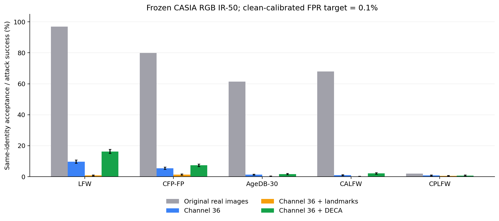

# 36 号通道条件重建的身份重放攻击评估

> 完成日期：2026 年 10 月 12 日。使用三组第 20 轮重建器和新训练的 CASIA RGB IR-50。主指标为重建 A 与同身份真实 B 的验证成功率 SRRA；阈值标定目标为 FPR=0.1%=0.001。本文补充[阶段性主报告](experiment_report_privacy_channel36_landmark_3dmm.md)与[条件重建实验](experiment_report_channel36_conditional_reconstruction.md)。

## 目的与威胁模型

本实验检查重建图是否仍能被识别为目标身份。参考 [AdvFace v1 第 5.1.4 节](https://arxiv.org/html/2305.05391v1#S5.SS1.SSS4)的重放攻击成功率 SRRA 概念，将重建图直接输入固定识别器，观察验证是否通过。关键点和 DECA 条件从重建源图提取，评估条件可获得时的联合攻击面。

AdvFace 使用 FaceNet、160×160 输入和不同训练设置，原文未完整说明 SRRA 的配对和阈值标定细节。本次明确采用 RGB IR-50、112×112 输入、真实配对十折校准协议；结果是参考其指标定义的实验，不是论文数值的精确复现。

## 模型、图像与数据

- **识别器**：现有原始 RGB 检查点不可用，CASIA 现有检查点为 162 通道 DCT 输入，因此从零训练 RGB IR-50＋ArcFace。训练清单含 452,740 张图像、10,572 个类别；GPU 4–7，四卡、每卡 batch 256、20 轮，最终使用第 20 轮冻结骨干，输出 512 维向量。主要训练参数列于[结果汇总](report_assets/channel36_report_update_20261012/results.json)。完整配置与启动记录保存在工作区原始日志。
- **重建器**：复用固定测试集实验的三组第 20 轮检查点，分别为仅 36 号、36 号＋106 点热图、36 号＋DECA 236 维参数。原始模型路径与 SHA256 记录保存在工作区评估日志中。
- **验证集**：LFW、AgeDB-30、CALFW、CPLFW 各 6,000 对，其中同身份 3,000 对、异身份 3,000 对；CFP-FP 为 7,000 对，其中两类各 3,500 对。总计 31,000 对、62,000 个配对图像位置；主攻击包含 15,500 次同身份 A→B 尝试。
- **图像输入**：已有对齐的 RGB 112×112 图像，归一化到 [-1,1]。重建输出裁剪到 [0,1]、四舍五入成 8 位 RGB 像素后再归一化；不重新检测或裁剪人脸。识别时将原方向和水平翻转方向的嵌入相加，再做 L2 归一化。翻转作用于提交给识别器的图像。

本阶段的 RGB 攻击识别器与原报告中 MS1Mv2 训练的频域识别学生不同；这里的低 FPR 原图 TPR 不能与先前最大配对准确率直接比较。

## 阈值如何得到，成功率如何计算

对于同身份真实配对 $(A_i,B_i)$，先由重建器得到 $\hat A_i=R(z(A_i),c(A_i))$，再比较重建图 $\hat A_i$ 与真实图 $B_i$。

令 $e(x)$ 为 L2 归一化的识别嵌入，使用平方 L2 距离：

$$d(x,y)=\lVert e(x)-e(y)\rVert_2^2=2-2\cos(e(x),e(y)).$$

每个数据集保留固定顺序的十折划分。评估第 $j$ 折时，仅用其余九折的**真实异身份配对**标定距离阈值 $\tau_j$，随后固定该阈值评估本折原图与三组攻击。每折所有重建方法共用阈值，重建分数不参与阈值选择。

若校准异身份配对数量为 $N_-$，将负样本距离升序排列，允许最多 $k=\lfloor0.001N_-\rfloor$ 次误接受，将阈值设为第 $k+1$ 小的距离。判断使用严格的 $d<\tau_j$；边界相等时拒绝。例如 LFW 每折校准有 2,700 个负样本，最多允许 2 次误接受，实际校准 FPR 为 0.0741%；CFP-FP 校准有 3,150 个负样本，最多允许 3 次，校准 FPR 为 0.0952%。测试折的 FPR 单独统计，可因有限样本及折间变化偏离 0.1%。

主指标的定义为：

$$\mathrm{SRRA}_{A\to B}=\frac{\sum_{i:y_i=1}\mathbf{1}[d(\hat A_i,B_i)<\tau_{\mathrm{fold}(i)}]}{\sum_i\mathbf{1}[y_i=1]}.$$

所有预定同身份配对均计入分母，包括原图 A、B 本身没有通过识别的配对。解码错误或非有限输出会终止实验；无效关键点使用零条件并保留尝试。本次完整五集评估已完成。

## 各验证集结果

表 1｜主攻击为 A→B；所有数值为百分比。原图 TPR 与实测 FPR 使用相同的逐折阈值。

| 数据集 | 原图 TPR | 实测原图 FPR | 36 号 SRRA | ＋关键点 SRRA | ＋DECA SRRA |
| --- | ---: | ---: | ---: | ---: | ---: |
| LFW | 96.93% | 0.10% | 9.63% | 0.73% | 16.27% |
| CFP-FP | 79.89% | 0.14% | 5.46% | 1.37% | 7.29% |
| AgeDB-30 | 61.43% | 0.10% | 1.23% | 0.20% | 1.63% |
| CALFW | 67.93% | 0.10% | 0.93% | 0.07% | 2.10% |
| CPLFW | 2.00% | 0.10% | 0.73% | 0.47% | 0.70% |

图 1｜灰柱表示原图 TPR，彩色柱为 A→B SRRA，误差线为逐配对计数的 95% Wilson 区间。共享身份或照片使尝试存在依赖，区间仅作描述性统计。[PDF 图表](report_assets/channel36_report_update_20261012/srra_by_dataset.pdf)可供下载。

## 合并统计与补充口径

表 2｜按成功次数与尝试次数合并；不是五个百分比的等权平均。

| 重建方法 | A→B 成功次数/尝试 | A→B SRRA | B→A SRRA | 双方向合并 SRRA | 条件 A→B SRRA | 源图匹配成功率 |
| --- | ---: | ---: | ---: | ---: | ---: | ---: |
| 36 号 | 567/15500 | 3.66% | 2.59% | 3.12% | 5.65% | 21.20% |
| 36 号＋关键点 | 92/15500 | 0.59% | 0.34% | 0.46% | 0.84% | 2.52% |
| 36 号＋DECA | 876/15500 | 5.65% | 4.32% | 4.99% | 8.83% | 31.23% |

各列的分母与比较对象如下：

- **A→B**：重建 A 对真实 B，15,500 次；这是主指标。36 号的成功次数为 $289+191+37+28+22=567$，故 $567/15500=3.66\%$。
- **B→A**：重建 B 对真实 A，同样 15,500 次；两方向的照片排列不同，因此结果可不同。
- **双方向合并**：合并 A→B 与 B→A，共 31,000 次，用于减小方向选择对总体结果的影响。
- **条件 A→B**：仅以原图 A、B 已被接受的同身份配对为分母，共 9,645 次；36 号、关键点、DECA 的成功次数分别为 545、81、852。
- **源图匹配**：每张重建图对其重建源图，即 $\hat A$ 对 A、$\hat B$ 对 B。统计全部配对的两张图像，共 62,000 次，成功次数分别为 13,143、1,560、19,363；这与跨照片认证是不同口径。

## 逐数据集成功次数与不确定性

| 数据集 | 重建方法 | 成功次数/同身份尝试 | A→B SRRA | 95% Wilson 区间 |
| --- | --- | ---: | ---: | ---: |
| LFW | 36 号 | 289/3000 | 9.63% | [8.63%, 10.74%] |
| LFW | 36 号＋关键点 | 22/3000 | 0.73% | [0.48%, 1.11%] |
| LFW | 36 号＋DECA | 488/3000 | 16.27% | [14.99%, 17.63%] |
| CFP-FP | 36 号 | 191/3500 | 5.46% | [4.75%, 6.26%] |
| CFP-FP | 36 号＋关键点 | 48/3500 | 1.37% | [1.04%, 1.81%] |
| CFP-FP | 36 号＋DECA | 255/3500 | 7.29% | [6.47%, 8.19%] |
| AgeDB-30 | 36 号 | 37/3000 | 1.23% | [0.90%, 1.70%] |
| AgeDB-30 | 36 号＋关键点 | 6/3000 | 0.20% | [0.09%, 0.44%] |
| AgeDB-30 | 36 号＋DECA | 49/3000 | 1.63% | [1.24%, 2.15%] |
| CALFW | 36 号 | 28/3000 | 0.93% | [0.65%, 1.35%] |
| CALFW | 36 号＋关键点 | 2/3000 | 0.07% | [0.02%, 0.24%] |
| CALFW | 36 号＋DECA | 63/3000 | 2.10% | [1.64%, 2.68%] |
| CPLFW | 36 号 | 22/3000 | 0.73% | [0.48%, 1.11%] |
| CPLFW | 36 号＋关键点 | 14/3000 | 0.47% | [0.28%, 0.78%] |
| CPLFW | 36 号＋DECA | 21/3000 | 0.70% | [0.46%, 1.07%] |

这些区间未按身份聚类。条件方法相对基线的配对 bootstrap 差值也保存在汇总 JSON 中，采用种子 1337、每个数据集重采样 3,000 次；同样是描述性区间。

## 结果解释与限制

DECA 在 LFW、CFP-FP、AgeDB-30、CALFW 的主攻击成功率均高于 36 号基线；CPLFW 为 0.70% 对 0.73%。五集合并 A→B 成功率从 3.66% 增至 5.65%，双方向合并从 3.12% 增至 4.99%，源图匹配从 21.20% 增至 31.23%。结合固定 1,000 张图像上更好的像素、结构与身份相似度指标，当前 DECA 条件提高了被测试重建器恢复可识别图像的能力。

关键点模型在本次各验证集的 A→B 成功率均低于原始基线，合并为 0.59%；固定测试集的四项重建指标也更差。但同检查点关闭关键点后重建进一步恶化，说明条件分支发挥了作用；较差的跨模型结果不能单独证明关键点没有身份信息，或证明其他攻击器也无法利用它。

**CPLFW 的原图 TPR 只有 2.00%，需要单独解释。** 异身份配对中有余弦相似度 0.8185、0.9719、0.9733 的高分样本，使 8/10 折的接受阈值升至约 0.8185。这里保留了全部配对与原始标签；未据此认定标签有误，也未删除难样本。识别器在该严格阈值下对真实配对已大量拒绝，CPLFW 的低 SRRA 不能单独作为隐私安全证据。

实际原图 FPR 为 0.10%–0.14%；实验使用校准目标阈值，没有声称每个测试集恰好达到 0.1%。CASIA 与验证集身份交叉尚未审计，结果限于当前识别器、数据和重建检查点。这里评估数字图像直接输入识别器，没有进行实体呈现或活体检测实验。

## 汇总与本地复核记录

[结果汇总 JSON](report_assets/channel36_report_update_20261012/results.json)包含条件重建指标、条件关闭消融、配对差值区间，以及五个验证集的原图性能、各口径攻击计数和描述性区间。公开图表由这些实验结果生成。

工作区 `recognition/logs/replay_attack_casia_rgb_20261012_01/` 保留完整逐折阈值、原始嵌入、配对分数、输入与模型哈希、训练配置和评估实现。已从原始嵌入独立重新计算距离及成功次数，并复核校准 FPR 预算；五个验证集全部通过。

像素重建阶段使用固定 IR-SE50 计算 ID cosine、固定 1,000 张 MS1Mv2 原图；本阶段使用新训练 RGB IR-50、五个配对验证集和量化后的重建图。两阶段提供互补证据，不应把 ID cosine 直接转换成 SRRA。
