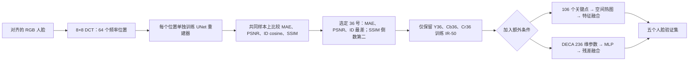
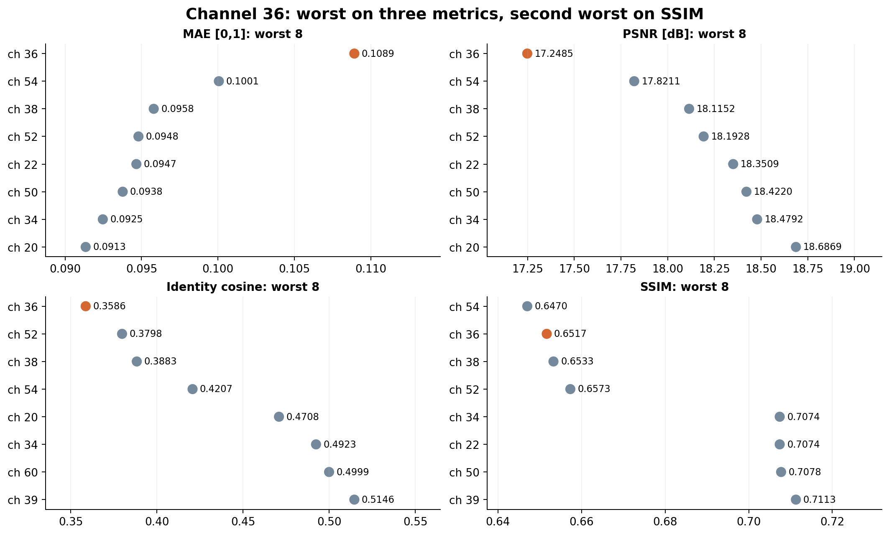
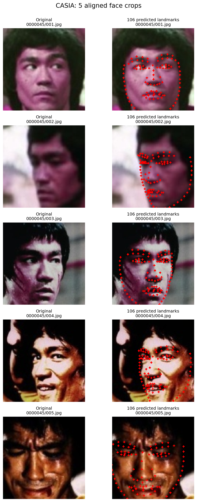
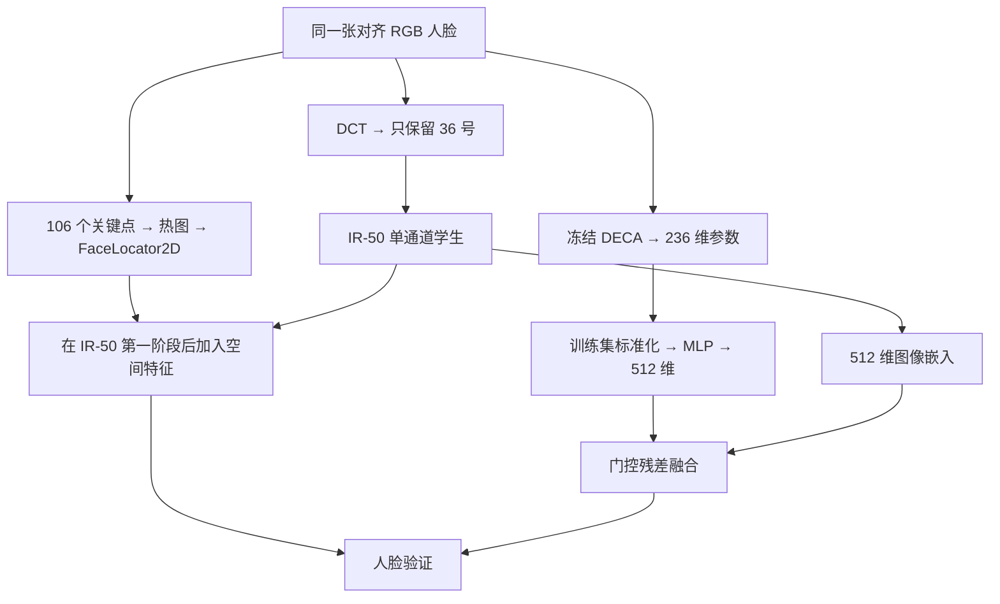
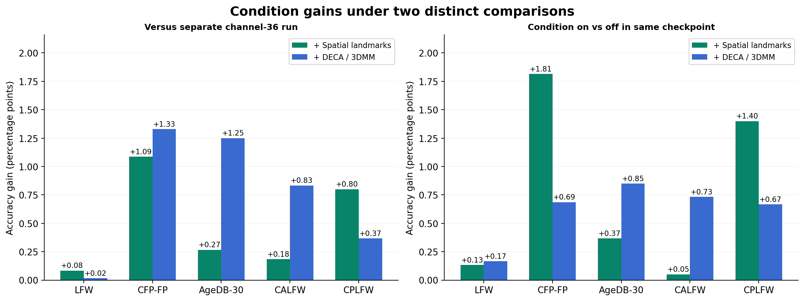

# 从最难重建的 DCT 通道到条件增强识别：36 号通道阶段性实验报告

> 实验范围：64 个单频率重建模型、36 号通道识别模型、空间关键点模型与 DECA/3DMM 模型。报告整理于 2026 年 10 月 12 日；识别结果均采用第 20 轮检查点。

## 1. 实验目的

这组实验希望在**降低人脸外观可重建性**的同时，尽量保留身份验证能力。我们先把对齐人脸分解到 8×8 DCT 的 64 个频率位置，分别训练重建模型，寻找在已测试的重建攻击下最难恢复原图的单一频率；然后只用该频率训练识别模型，观察精度损失，并尝试通过人脸关键点和 3DMM 参数补回一部分识别信息。

整条路线包含三个需要分别回答的问题：**哪个单通道最难重建？单通道还能识别吗？额外几何条件能否提高它的识别率？**“重建困难”与“隐私得到保证”之间还隔着完整的攻击评估，尤其当额外条件也来自原始人脸时，不能只凭单通道重建结果宣称整个系统安全。

## 2. 第一阶段：穷举 64 个通道的重建效果

### 2.1 评估设置

DCT 通道使用 **0 起始索引**，36 号对应 8×8 频率矩阵的第 4 行、第 4 列；一个索引保留 Y、Cb、Cr 三个颜色分量，所以单频率模型输入为 3 张特征图。64 个独立的 UNet 重建模型均在 CASIA 上训练 20 个 epoch，再在同一份 MS1Mv2 清单上评估：固定 **1,000 张图像，每个身份一张**，随机种子为 1337。所有通道使用相同原图、重建协议和身份特征提取器，减少样本差异对排名的影响。[评估记录](report_assets/privacy_channel36_20261012/evidence/reconstruction_summary.json)保存了图像清单哈希、模型路径与预处理约定；[SSIM 记录](report_assets/privacy_channel36_20261012/evidence/reconstruction_ssim_summary.json)使用同一清单。

四个指标从不同角度描述重建效果：MAE 是平均像素绝对误差，**越大说明重建越差**；PSNR 衡量像素重建保真度，越低越差；SSIM 衡量结构相似度，越低越差；ID cosine 是原图与重建图经过同一个 IR-SE50 身份特征模型后的余弦相似度，越低表示该模型提取的身份特征保留越少。这里的 ID cosine **不是配对识别准确率**，也没有验证阈值。四项指标都在 PNG 量化之前计算。

### 2.2 64 通道全景

**图 1｜64 个通道的重建指标。** 每个小格对应一个零起始 DCT 位置；图中四幅热图各有自己的色标。36 号位于索引矩阵的 `[4,4]`，在 MAE、PSNR 和 ID cosine 上落在各自最差的一端。SSIM 也处于最差区域，但它的最低值属于 54 号通道。

**图 2｜四项指标各自最差的八个通道。** 排名来自同一批 1,000 张 MS1Mv2 图像。36 号在 MAE、PSNR、ID cosine 三项中都是第 1 差，在 SSIM 中是第 2 差；这是选择它作为后续识别输入的依据，而不是说它在每一项指标上都绝对最差。

表 1｜代表性单通道重建结果。MAE 越高越差，其余三项越低越差；各列均为逐图计算后取平均。

| DCT 通道 | MAE ↑ | PSNR ↓ / dB | ID cosine ↓ | SSIM ↓ |
| --- | ---: | ---: | ---: | ---: |
| **36** | **0.1089** | **17.2485** | **0.3586** | 0.6517 |
| 54 | 0.1001 | 17.8211 | 0.4207 | **0.6470** |
| 38 | 0.0958 | 18.1152 | 0.3883 | 0.6533 |
| 52 | 0.0948 | 18.1928 | 0.3798 | 0.6573 |
| 0（PSNR 最好） | 0.0097 | 36.8517 | 0.9945 | 0.9818 |

0 号通道的 PSNR 达到 36.85 dB，而 36 号只有 17.25 dB；36 号的平均身份余弦相似度也降至 0.3586。由此可以说，**在这组已训练的单通道 UNet 和这份固定样本上，36 号是综合最难重建的候选通道**。这仍是对特定攻击器、训练数据和测试样本的经验结果。

### 2.3 实际重建图像

**图 3｜固定样本的真实重建输出。** 四行取自原评估图中预先固定的前四张图，没有按误差挑选；每行依次为原图、0、36、54、38、52 号通道的重建图。36 号重建图的五官细节和局部纹理明显受损，但仍可见人脸轮廓，说明“最差重建”并不等于图像或身份信息完全不可恢复。仓库工作区的 `recognition/reconstruct_outputs/ms1mv2_sweep64_epoch20/visualizations/` 保留了八张固定样本和全部 64 个通道的结果；报告图表提供前四张的对照。

## 3. 第二阶段：只用 36 号通道训练识别模型

重建难度提供了通道选择依据，但识别模型是否还能利用该通道，需要单独训练检验。36 号识别学生仅接收 Y36、Cb36、Cr36 三张 DCT 特征图，不接收 RGB 图或重建图。学生采用 IR-50 骨干、512 维嵌入和 ArcFace 分类头；训练集是 MS1Mv2。这里展示的稳定单通道基线，还使用一个冻结的、输入 54 个高频 DCT 位置的 IR-50 教师做特征与中间层蒸馏。学生和教师的最后检查点均为第 20 轮。

验证使用 LFW、CFP-FP、AgeDB-30、CALFW、CPLFW 五个人脸配对数据集。每张图取原图与水平翻转的嵌入并融合，再按同一套 **10 折配对验证**协议计算准确率。表中的“五集平均”是五个数据集准确率的等权平均，并非合并所有配对后的整体准确率。

单通道基线的五集平均准确率为 **92.89%**，54 高频教师为 **96.78%**，相差 **3.90 个百分点**。差距在 CFP-FP 和 CPLFW 上尤为明显，提示侧脸和复杂姿态验证仍是单通道模型的弱点。教师输入更丰富，可以展示单通道损失的量级；它是**54 高频 DCT 模型，不是原始 RGB 模型**。当前实验记录中缺少同训练和测试协议的 RGB 基线，因此不把上述 3.90 个百分点写作“与真实图片模型的差距”。

## 4. 第三阶段：给 36 号识别模型加入额外条件

单通道输入压低了已测试重建器的恢复能力，也使识别模型丢失了一部分几何与外观线索。后续两条路线保持学生的 36 号 DCT 输入，分别从**同一张对齐 RGB 人脸裁剪图**提取关键点或 DECA 参数，再把条件送入识别网络。训练时仍使用 54 高频教师蒸馏；验证时同样需要生成对应条件。这一点直接影响实际隐私边界：如果只开放 36 号通道、却不开放原图，也需要有办法提供或保护这些辅助条件。

### 4.1 空间关键点条件

关键点实验先预测对齐人脸的 **106 个二维点**，再把点栅格化为 112×112 热图，送入卷积式 `FaceLocator2D`。得到的空间特征在 IR-50 第一阶段后加到主干特征图上，再继续生成 512 维身份嵌入。训练中对关键点和条件分支做随机丢弃；水平翻转图像时同步变换关键点。报告的主结果采用[空间融合模型](report_assets/privacy_channel36_20261012/evidence/spatial_landmark_fusion.py)，而非早期的关键点坐标向量融合版本。

**图 4｜关键点条件的实际输入示例。** 图中是 CASIA 已对齐人脸上的 106 点预测预览，展示条件提取的形式；它不是五个验证集准确率的样本截图，也不用于证明关键点一定预测正确。训练与验证均按各自图像生成关键点。

### 4.2 DECA / 3DMM 参数条件

3DMM 路线使用冻结的官方 DECA `E_flame` 编码器，从对齐 RGB 裁剪图提取 **236 维参数**：形状 100、纹理 50、表情 50、姿态 6、相机 3、光照 27。编码器参数训练时保持冻结；参数使用训练集统计量标准化，经小型 MLP 映射至 512 维，并通过可学习门控，以残差形式与 36 号通道图像嵌入融合。测试原图和水平翻转图时，DECA 分别从对应的裁剪图提取参数。训练配置见 [DECA 配置快照](report_assets/privacy_channel36_20261012/evidence/deca_config.yaml)，融合实现见 [deca_fusion.py 快照](report_assets/privacy_channel36_20261012/evidence/deca_fusion.py)。

两种条件的融合位置不同：空间关键点较早进入特征图，DECA 参数在末端嵌入上做融合。因此二者的结果可以作为两条增强路线的比较，但不能简单解读为“236 维 3DMM 本质上比 106 点更有效”。

## 5. 五个验证集上的识别结果

**图 5｜第 20 轮模型在五个验证集上的配对准确率。** 关键点和 DECA 两条路线的五集平均都高于单通道基线，但仍低于输入 54 高频位置的教师。图中纵轴未从零开始，精确值与差异以表 2 为准。

表 2｜第 20 轮 10 折配对验证准确率，单位为百分比。最后一列对五个数据集等权平均。

| 模型输入 / 方法 | LFW | CFP-FP | AgeDB-30 | CALFW | CPLFW | 五集平均 |
| --- | ---: | ---: | ---: | ---: | ---: | ---: |
| 36 号通道，蒸馏基线 | 99.37 | 90.11 | 93.90 | 94.35 | 86.70 | 92.89 |
| 36 号 + 空间关键点 | **99.45** | 91.20 | 94.17 | 94.53 | **87.50** | 93.37 |
| 36 号 + DECA / 3DMM | 99.38 | **91.44** | **95.15** | **95.18** | 87.07 | **93.65** |
| 54 高频通道教师 | 99.77 | 97.97 | 98.05 | 96.03 | 92.10 | 96.78 |

相对独立训练的 36 号基线，空间关键点在五个数据集上分别提升 **0.08、1.09、0.27、0.18、0.80 个百分点**，五集平均提升 **0.48 个百分点**；DECA 分别提升 **0.02、1.33、1.25、0.83、0.37 个百分点**，平均提升 **0.76 个百分点**。关键点在 LFW 和 CPLFW 上略高于 DECA；DECA 在 CFP-FP、AgeDB-30、CALFW 上更高。两者在五个数据集上都没有完全追回 54 高频教师的表现。

**图 6｜两种比较所回答的问题不同。** 左图把条件模型与独立训练的 36 号基线比较，衡量最终模型结果；右图在同一个条件模型的检查点内，比较开启条件与只取图像分支的推理结果，直接观察推理时辅助分支的贡献。空间关键点开启后的同检查点五集提升为 **0.05～1.81 个百分点**；DECA 为 **0.17～0.85 个百分点**。因为分支关闭时模型的主干也经历了条件训练，右图仍不能单独拆出条件分支对整个训练过程的因果贡献。

早期还试过把 106 点坐标直接接到末端嵌入上的[向量融合版本](report_assets/privacy_channel36_20261012/evidence/recognition_landmark_vector.json)：它的五集平均仅为 **92.93%**，CFP-FP 还低于独立基线。空间热图版本的结果更稳定，因此本报告把它作为“关键点条件”主实验，保留向量版本作为方法迭代记录。

## 6. 结论与证据边界

目前的结果形成了一条明确的实验链：**36 号在已测试单通道重建器上最难恢复；只用它仍能达到 92.89% 的五集平均配对准确率；加入空间关键点或 DECA 参数后，平均准确率分别提高到 93.37% 和 93.65%。** 这说明在单频率识别输入受限时，额外几何条件能改善已有模型的验证表现。

这份阶段性结论有四个边界。第一，重建排序来自 CASIA 训练的 UNet 和固定的 1,000 张 MS1Mv2 样本；CASIA 与 MS1Mv2 的人物交叉未单独审计，其他架构或更强攻击可能改变排名。第二，36 号重建图仍有人脸形状，低 PSNR、低 SSIM 和低 ID cosine 不能替代攻击成功率、身份泄露率或正式隐私保证。第三，关键点与 DECA 都从原始 RGB 图获得；若这些条件会被传输或保存，需要把它们与 36 号通道**一起**纳入攻击面，重新评估可重建性与可识别性。第四，DECA 实验的每卡 batch 为 512，而基线和空间关键点实验每卡 batch 为 128，均为四卡训练；跨训练运行的精度差异也可能包含 batch 大小的影响。这里报告观察到的效果，不把差异全部归因于条件表示。

下一阶段最关键的实验，是固定数据、batch 和训练预算，分别对“36 号通道”“36 号 + 关键点”“36 号 + DECA 参数”的**完整可见输入**训练或适配同等强度的重建与身份攻击。与此同时补齐同协议 RGB 识别基线、多随机种子验证，以及辅助条件关闭、打乱、量化或加噪的消融。这样才能判断新增条件是否真正改善了“隐私与识别”的整体权衡。

## 7. 数据、图表与复现入口

- 64 通道重建结果：[逐图摘要](report_assets/privacy_channel36_20261012/evidence/reconstruction_summary.json)、[SSIM 摘要](report_assets/privacy_channel36_20261012/evidence/reconstruction_ssim_summary.json)、[原始报告快照](report_assets/privacy_channel36_20261012/evidence/reconstruction_report.md)。本报告图表的数值副本见 [reconstruction_metrics.csv](report_assets/privacy_channel36_20261012/reconstruction_metrics.csv)。
- 识别结果：[36 号基线](report_assets/privacy_channel36_20261012/evidence/recognition_channel36.json)、[空间关键点](report_assets/privacy_channel36_20261012/evidence/recognition_landmark_spatial.json)、[DECA 复测](report_assets/privacy_channel36_20261012/evidence/recognition_deca.json)、[54 高频教师](report_assets/privacy_channel36_20261012/evidence/recognition_teacher.json)。汇总数据见 [recognition_metrics.csv](report_assets/privacy_channel36_20261012/recognition_metrics.csv)。
- 所有新生成的图同时保存了 PNG 和 SVG，位于 [图表目录](report_assets/privacy_channel36_20261012/)；绘图逻辑见 [build_privacy_channel36_report_figures.py](build_privacy_channel36_report_figures.py)。图中真实人脸样本与关键点预览来自既有实验产物；没有生成合成人脸图。

### 主要论断与证据对应

| 论断 | 直接证据 | 适用范围 |
| --- | --- | --- |
| 36 号是本轮最难重建的候选通道 | 表 1、图 1～3；三项最差，SSIM 倒数第二 | 固定样本与已训练的单通道 UNet |
| 两种辅助条件均提高了最终验证准确率 | 表 2、图 5～6；五集平均分别增加 0.48 和 0.76 个百分点 | 当前各自训练配置与五个配对验证集 |
| 辅助分支在同一模型内也有贡献 | 图 6 右；条件开启后的五集提升均为正 | 当前检查点的推理消融 |

### 稿件自检

| 维度 | 当前判断 | 后续证据 |
| --- | --- | --- |
| 贡献 | 给出重建排名到条件识别的完整阶段路线 | 增加完整输入的攻击测试以验证隐私收益 |
| 表述 | 36 号的选择依据、输入形式和评估协议已明确 | 对外发表前核对数据使用与图像展示约定 |
| 实验强度 | 两条条件路线均在五集上高于独立基线 | 相同 batch、多种子和置信区间 |
| 评估完整性 | 覆盖像素、结构、身份相似度与识别准确率 | 更强重建器、攻击成功率、实际威胁模型 |
| 方法合理性 | 条件可提升识别，但也引入新的可见信息 | 测试条件的泄露、压缩与加噪代价 |
