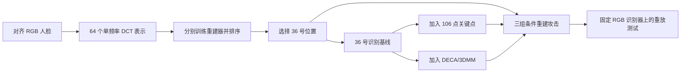
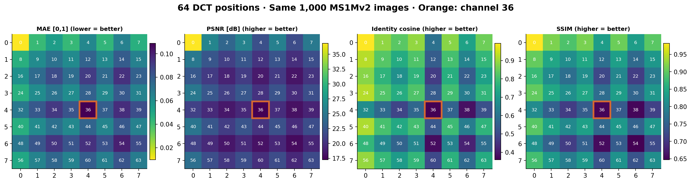
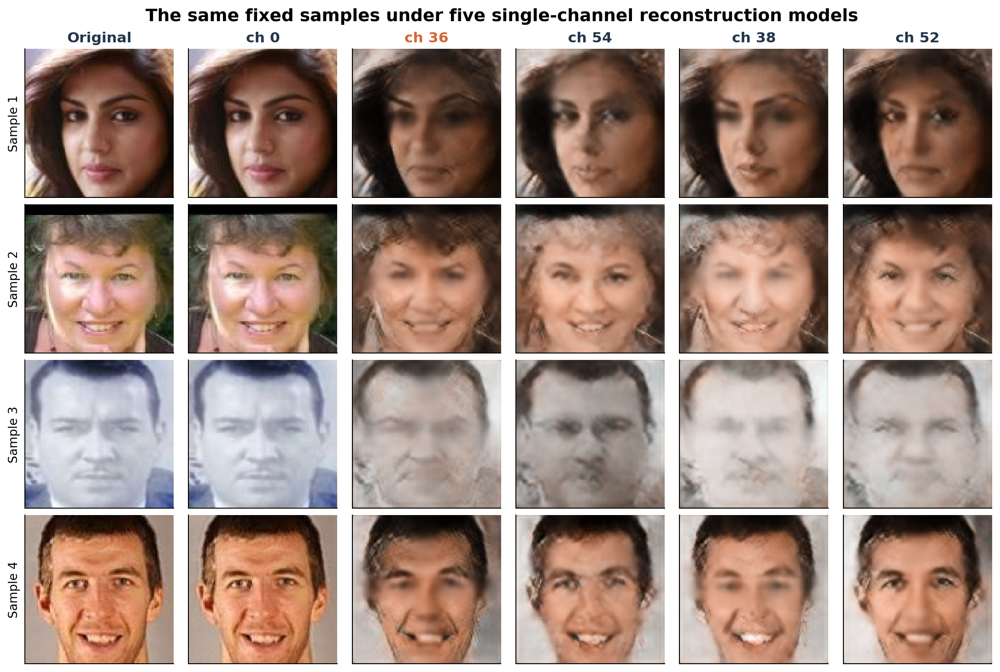
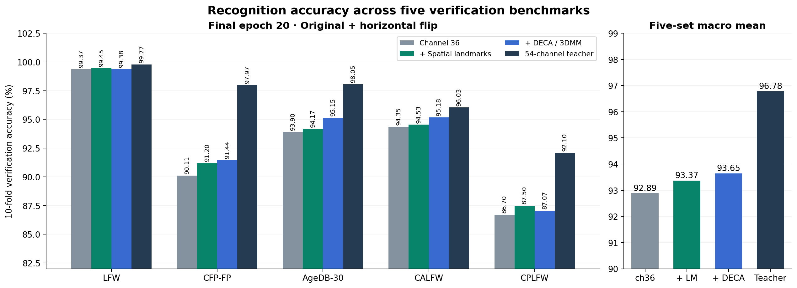
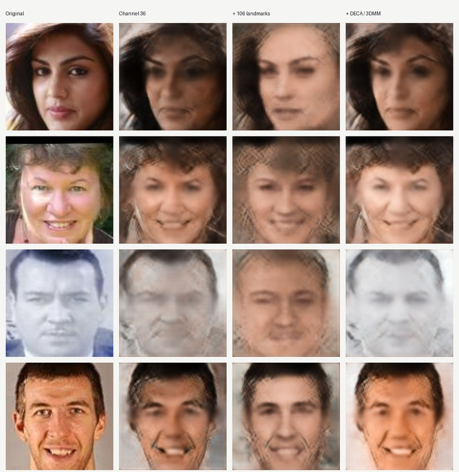
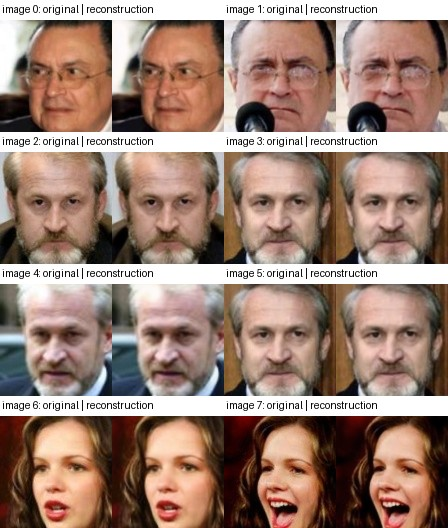

# 单通道频域人脸识别的隐私与效用实验报告

> 更新日期：2026 年 10 月 14 日。本文汇总 64 通道重建扫描、36 号通道识别、关键点与 3DMM 条件、条件重建、身份重放攻击及无保护基线。百分比均来自已完成实验；不同训练集、模型和阈值口径在文中分别注明。

## 摘要

本实验希望在保留人脸验证能力的同时，减少输入表示可被还原成原始人脸的程度。先对 8×8 DCT 的 64 个频率位置分别训练重建器，在统一的 1,000 张测试图像上选出最难重建的 **36 号位置**；再只用该位置在 Y、Cb、Cr 中的三个分量训练识别模型。36 号模型在五个验证集上的平均配对准确率为 **92.89%**。加入 106 点空间关键点或 DECA/3DMM 参数后，平均准确率分别达到 **93.37%** 和 **93.65%**。

隐私侧的结果更复杂。关键点条件使当前重建器的四项重建指标都变差；DECA 条件则使 MAE、PSNR、SSIM 明显改善，但身份余弦相似度只从 **0.3586** 升至 **0.3955**。在独立的 CASIA RGB IR-50 识别器上，以真实异身份配对标定约 0.1% FPR 阈值，36 号、关键点、DECA 三组重建图在 LFW 上的跨照片重放成功率分别为 **9.63%、0.73%、16.27%**。这些结果支持“当前 36 号表示在已测试攻击下比无保护早期特征更难恢复身份”的经验判断，但不构成普遍的隐私保证。

## 1. 实验问题与流程

我们关心三个连续问题：**能否找到难重建的单个频率位置？该位置能否支撑识别？补充几何条件后，识别收益是否伴随新的重建风险？** 这要求把识别准确率、图像重建质量和身份重放成功率分开测量。模型的输入是零起始索引的 DCT 频率位置；36 号对应 8×8 网格中的 `[4,4]`，保留 Y36、Cb36、Cr36 三张特征图。关键点和 DECA 条件均从同一张对齐 RGB 人脸提取，因此部署时若向外提供这些条件，它们也是攻击者可能获得的信息。

此前还做过 54 个高频位置输入的识别模型依赖分析：其五集平均准确率为 **94.21%**；去掉 DCT 40 和 DCT 7 分别使平均准确率下降 **10.42** 和 **4.09** 个百分点，gate 分数与消融下降的 Spearman 相关为 **−0.109**。这说明通道判别贡献很不均匀，也提醒我们不能用门控权重代替实际消融。**这组 54 通道实验回答的是识别依赖问题；36 号由独立的重建困难度扫描选出。** 两组模型属于不同运行，数值不作直接性能排序。详见[高频通道依赖报告](experiment_report_full_model_channel_dependency.md)。

## 2. 从 64 个频率位置选出 36 号

64 个单频率 U-Net 重建器均在 CASIA 上训练 20 轮，并在同一份 MS1Mv2 清单上测试：固定 1,000 张图像，每个身份一张。每个模型只输入对应频率的 Y、Cb、Cr 特征。以逐图平均的 MAE、PSNR、SSIM 评价图像质量，并用固定 IR-SE50 计算原图与重建图的身份嵌入余弦相似度。这里的 ID cosine 没有认证阈值，**不能直接当作攻击成功率**。

<em>图 1｜64 个单频率重建器的统一测试结果。橙框标出 36 号位置。</em>

| 频率位置 | MAE ↓越好 | PSNR / dB ↑越好 | SSIM ↑越好 | ID cosine ↑越好 |
| --- | ---: | ---: | ---: | ---: |
| **36** | **0.1089** | **17.2485** | 0.6517 | **0.3586** |
| 54 | 0.1001 | 17.8211 | **0.6470** | 0.4207 |
| 38 | 0.0958 | 18.1152 | 0.6533 | 0.3883 |
| 52 | 0.0948 | 18.1928 | 0.6573 | 0.3798 |
| 0 | 0.0097 | 36.8517 | 0.9818 | 0.9945 |

36 号的 MAE 最高，PSNR 和 ID cosine 最低，SSIM 为倒数第二；因此它是**当前单频率 U-Net 与该测试集下**综合最难重建的候选，而非所有攻击器下的数学最优通道。原图和不同通道的固定样本对照见图 2。36 号重建图仍保留部分人脸轮廓，视觉上“模糊”不等于身份不可推断。[64 通道详细报告](experiment_report_privacy_channel36_landmark_3dmm.md)给出排序图、逐图协议与模型证据。

<em>图 2｜固定样本的原图及五个单通道重建结果；各行展示同一张人脸。</em>

## 3. 36 号通道识别基线与辅助条件

识别学生使用 IR-50、ArcFace、512 维嵌入，以 MS1Mv2 训练 20 轮，输入仅为 Y36、Cb36、Cr36。基线及两组条件模型均接受冻结的 54 高频位置教师蒸馏。关键点版本把 106 点坐标变为 112×112 热图，经 `FaceLocator2D` 提取空间特征，在 IR-50 的早期特征层融合。DECA 版本使用冻结的 `E_flame` 编码器提取 236 维形状、纹理、表情、姿态、相机和光照参数，经标准化和 MLP 映射后，在末端嵌入处做门控残差融合。两种条件的融合位置不同。

五个验证集使用真实配对、原图与水平翻转的嵌入融合，以及十折验证准确率。表中平均值是五个数据集**等权平均**，并非将全部配对合并后计数。

| 方法 | LFW | CFP-FP | AgeDB-30 | CALFW | CPLFW | 五集平均 |
| --- | ---: | ---: | ---: | ---: | ---: | ---: |
| 36 号，蒸馏基线 | 99.37% | 90.11% | 93.90% | 94.35% | 86.70% | **92.89%** |
| 36 号＋空间关键点 | 99.45% | 91.20% | 94.17% | 94.53% | 87.50% | **93.37%** |
| 36 号＋DECA/3DMM | 99.38% | 91.44% | 95.15% | 95.18% | 87.07% | **93.65%** |
| 54 高频位置教师 | 99.77% | 97.97% | 98.05% | 96.03% | 92.10% | 96.78% |

<em>图 3｜第 20 轮检查点的识别准确率。精确差值以表中数值为准。</em>

相对基线，关键点和 DECA 的五集平均分别提高 **0.48** 与 **0.76 个百分点**；两者均未达到 54 高频教师的 96.78%。这是已训练模型间的观察差异，不能完全归因于条件本身：DECA 运行每卡 batch 为 512，基线和关键点为 128；额外条件也都来自原始 RGB 图。早期 106 点坐标向量融合版本仅达到 92.93%，因此正式关键点实验采用空间热图版本。[阶段报告](experiment_report_privacy_channel36_landmark_3dmm.md)记录了同检查点关闭条件的消融与实现细节。

## 4. 辅助条件是否使人脸更容易重建？

在相同的 1,000 张 MS1Mv2 测试图像上，比较仅用 36 号的原重建器，以及另外训练 20 轮、分别加入 106 点热图和 DECA 236 维参数的重建器。关键点拼接到 U-Net 输入；DECA 参数调制瓶颈特征。三个模型都使用 CASIA 训练。由于条件来自源 RGB 图像，这里评估的是**频率与可获得辅助条件的联合攻击面**。

<em>图 4｜原始对照图的前四个固定样本及三种重建输出；图像展示外观差异，定量判断以表中数值为准。</em>

| 重建器 | MAE ↓ | PSNR / dB ↑ | SSIM ↑ | ID cosine ↑ |
| --- | ---: | ---: | ---: | ---: |
| 仅 36 号 | 0.1089 | 17.2485 | 0.6517 | 0.3586 |
| 36 号＋关键点 | 0.1426 | 15.0404 | 0.5168 | 0.1628 |
| 36 号＋DECA/3DMM | **0.0773** | **19.5242** | **0.7004** | **0.3955** |

关键点模型相对无条件基线在四项指标上都更差；同一关键点检查点在推理时关闭条件后还会进一步恶化，说明它确实使用了条件，不能据此断言关键点本身完全没有可泄露的信息。DECA 模型的 **PSNR 增加 2.28 dB、SSIM 增加 0.0488、MAE 降低 0.0316**，像素与结构重建改善明确；ID cosine 只增加 **0.0368**。因此，“两个条件都几乎不提升重建”不符合这批数据；更准确的结论是**关键点没有改善当前攻击器，而 DECA 改善外观重建，身份嵌入相似度增幅较小**。详细配对 bootstrap 区间、关闭条件消融及训练设置见[条件重建报告](experiment_report_channel36_conditional_reconstruction.md)。

## 5. 重建图的身份重放攻击

仅凭 PSNR 或 ID cosine 难以回答“重建图能否通过识别器”。我们另在 CASIA 上训练 20 轮 RGB IR-50＋ArcFace，冻结后用于攻击评估。它与上一节的 IR-SE50 指标模型、以及 MS1Mv2 上训练的 36 号识别学生均不同；它是**独立训练的固定攻击识别器**，不是前述 54 高频教师。攻击图量化为 8 位 RGB 后输入识别器，原图与水平翻转特征融合并做 L2 归一化。

主指标为跨照片重放：对同身份真实配对 `(A, B)`，从 A 的 36 号表示及可获得的条件重建 `Â`，再比较 `Â` 与真实图 B。各数据集按十折划分；测试一折时，只用其余九折的**真实异身份配对**标定约 0.1% FPR 的距离阈值。原图 TPR 与三种 SRRA 共用该阈值，重建分数不参与标定。SRRA 的分母包含全部同身份配对，即使原图配对本身未通过。LFW、AgeDB-30、CALFW、CPLFW 各有 3,000 次 A→B 尝试，CFP-FP 有 3,500 次。

| 数据集 | 原图 TPR | 实测 FPR | 36 号 SRRA | ＋关键点 SRRA | ＋DECA SRRA |
| --- | ---: | ---: | ---: | ---: | ---: |
| LFW | 96.93% | 0.10% | 9.63% | 0.73% | 16.27% |
| CFP-FP | 79.89% | 0.14% | 5.46% | 1.37% | 7.29% |
| AgeDB-30 | 61.43% | 0.10% | 1.23% | 0.20% | 1.63% |
| CALFW | 67.93% | 0.10% | 0.93% | 0.07% | 2.10% |
| CPLFW† | 2.00% | 0.10% | 0.73% | 0.47% | 0.70% |

<em>图 5｜固定低 FPR 阈值下的原图通过率与重建图跨照片重放成功率。</em>

跨五集合并的 A→B 成功次数分别为 **567/15,500＝3.66%**、**92/15,500＝0.59%**、**876/15,500＝5.65%**。DECA 在四个数据集上使 SRRA 高于无条件基线，说明它带来的身份泄露风险不能只用较小的 ID cosine 增量概括。关键点模型在当前攻击设置下的成功率更低。完整阈值、双向攻击、源图匹配及置信区间见[重放攻击报告](experiment_report_channel36_replay_attack.md)。这些 SRRA 与上述识别准确率使用不同模型和判定规则，不能直接相减。

**† CPLFW 必须单独解释。** 同一 RGB IR-50 在 CPLFW 上的常规十折最佳阈值准确率为 **88.13%（5288/6000）**，而表中的 2.00% 是极严格的约 0.1% FPR 下 **60/3000 的原图 TPR**。在两对无可辨人脸的异身份样本影响下，阈值显著抬高；仅让这两对不参与阈值标定的敏感性分析中，原图 TPR 变成 **16.00%**，三组 SRRA 为 **1.30%、0.97%、1.10%**。因此不能用 CPLFW 的 2.00% 或对应低 SRRA 单独证明防护效果。原始数据和标签没有改动；复核记录保存在 `recognition/logs/replay_attack_casia_rgb_20261012_01/cplfw_tpr_audit.md`。

## 6. 无保护早期特征基线与口径边界

为了给重放成功率一个参照，另将同一冻结 RGB IR-50 的未扰动早期特征 `input_layer + body[0]`（`64×56×56`）作为无保护表示，在 50,000 张 CASIA 图像上训练残差卷积解码器 8 轮，重建 112×112 RGB。该特征保留大量低层图像信息；它既不是原图直接复制，也**不是最终 512 维身份模板**。LFW 重建 PSNR 为 **39.58 dB**，与源图的嵌入余弦中位数为 **0.9975**，同源回放成功率为 100%。

<em>图 6｜LFW 固定样本的原图与无保护早期特征重建；该表示与 36 号 DCT 输入不等价。</em>

| 数据集 | 无保护 A→B SRRA，约 0.1% FPR | 36 号 A→B SRRA，同阈值 | 无保护 A→B SRRA，最佳准确率阈值 |
| --- | ---: | ---: | ---: |
| LFW | 97.07% | 9.63% | 99.10% |
| CFP-FP | 79.54% | 5.46% | 93.86% |
| AgeDB-30 | 60.00% | 1.23% | 93.37% |
| CALFW | 67.43% | 0.93% | 90.13% |
| CPLFW† | 1.87% | 0.73% | 81.43% |

这个对照显示：在同一个固定 RGB 识别器、同一配对和严格阈值下，未扰动早期特征几乎完整保留了可回放身份，而当前 36 号重建器远未达到该水平。但两种表示的维度、来源和解码器训练难度不同，表中的差距**不是受控的“单通道保护增益”因果估计**。此处的“无保护 SRRA”也不是 [AdvFace 论文](https://arxiv.org/html/2305.05391v1) 的精确复现：论文使用 FaceNet、160×160 输入和不同的重建器、数据与阈值细节。原始结果与两种阈值的复算说明保存在 `recognition/logs/unprotected_feature_replay_20261014/report.md`。

## 7. 结论与适用范围

已完成实验形成一条可检验的证据链：在 64 个单频率候选中，36 号对当前 U-Net 最难重建；只用它仍有 92.89% 的五集平均验证准确率；关键点和 DECA 条件分别把准确率提高到 93.37% 与 93.65%。安全测试表明，关键点没有提高当前重建攻击的能力；DECA 使外观质量和部分数据集的身份重放成功率提高，因此若系统披露 DECA 参数，必须把它纳入威胁模型。当前 36 号重建图在已测试的固定 RGB IR-50 上比无保护早期特征难以跨照片回放，但不能据此宣称任意识别器或更强重建攻击都无法识别。

结果的主要限制是：64 通道选择及条件重建只测试了给定 U-Net、训练协议和固定 1,000 张样本；CASIA 与各验证数据的身份重合尚未审计；识别模型间存在 batch 设置差异；关键点和 DECA 需要访问原始 RGB；CPLFW 的低 FPR 阈值受到异常无脸负样本影响。后续若要给出更稳健的隐私结论，应使用独立且经质量审计的负样本集固定阈值，并测试更强、更广泛的重建器和识别器。本文所有结论均限定为这些已完成实验的经验观察。
